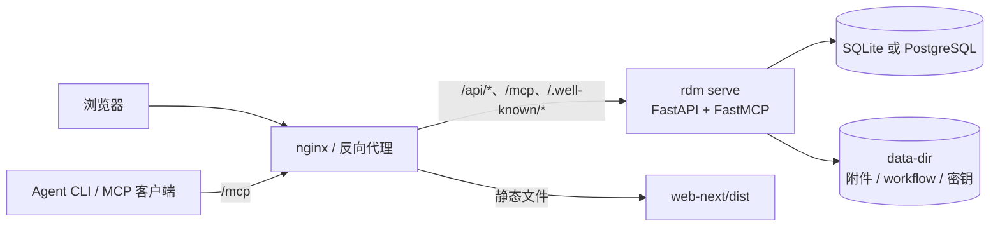

# 架构概览

本文面向使用者、集成方与 AI Agent，说明 rdm 由哪些部分组成、运行时如何协作、核心领域模型与
扩展点。设计过程与历史裁决（§16/§17）归档在
[internal/architecture.md](internal/architecture.md)，不是当前使用说明。

## 设计哲学

- **渐进式引入 Agent**：不重塑团队熟悉的敏捷流程。AI Agent 以正式成员身份进入项目——有自己的账号、
  项目角色、待办与信箱，从承担单个任务开始，逐步参与需求、开发、评审、测试与发布；自动化程度随
  流程成熟度逐步提高，而不是一次性替换。
- **协作有边界**：状态机、命名步骤、审批与 gate 由服务端强制执行；人机同权，但不能绕过流程。
- **MCP 优先**：Agent 通过 MCP 工具工作，人类通过 Web 工作，二者共享同一套领域规则与 REST 契约。
- **单组织、自托管、默认回环**：初始化即创建默认组织；进程默认监听 `127.0.0.1`，
  企业内网/容器部署可绑定内网地址并由反向代理对外；敏感恢复端点始终仅限本机回环。
- **默认简单、可选增强**：SQLite 开箱即用；需要共享数据库或中文全文搜索时切换 PostgreSQL + ParadeDB。

## 系统组成



| 组件 | 说明 |
|---|---|
| `rdm serve` | 唯一运行时进程：REST API、MCP endpoint、OAuth 授权服务、Webhook worker |
| `rdm` CLI | 初始化、迁移、账号/项目/用户管理、MCP/skills 集成、自检 |
| `web-next/` | React 18 + Vite + Atlassian Design System 的 SPA，独立构建、由 nginx 托管 |
| MCP skills | 随 wheel 发布的 `rdm-workflow` / `rdm-mailbox` agent 操作规范，可用 `rdm skills install` 安装 |

Python 进程**不托管前端静态资源**：生产环境由 nginx 托管 `web-next/dist`，并只反代
`/api/*`、`/mcp`、`/.well-known/*` 三类路径。

## 分层结构

后端位于 `src/rdm/`，依赖方向固定为：

```
interfaces（HTTP / MCP / CLI）
        ↓
application（用例、服务、端口）
        ↓
domain（实体、值对象、工作流规则、错误、事件）
        ↑
infrastructure（数据库、迁移、文件、Webhook 等适配器）
```

- **domain**：业务规则与状态机语义，不依赖框架与 I/O。
- **application**：编排用例，定义端口接口；事务边界（Unit of Work）在这里。
- **infrastructure**：SQLAlchemy 仓储、Alembic 迁移、文件存储、Webhook 投递等适配实现。
- **interfaces**：FastAPI 路由、FastMCP 工具、Typer CLI；只做协议转换与鉴权。
- 组合根只有 `src/rdm/app.py`；UoW 是唯一提交点，避免隐式事务。

## 核心领域模型

- **Organization（单组织）**：初始化时创建，组织角色包括 `org_owner`（唯一）、`user_manager`、
  `project_director`。
- **User**：`human` 或 `agent`。Agent 归属一个 human manager，随 manager 加入项目，不能单独增删。
- **Project / ProjectMember**：项目归属组织；成员关系挂在 human 上，项目角色为
  `project_owner / manager / sprint_manager / worker`。
- **WorkItem**：`epic / story / task / issue` 四类；task 还有 `task_type`（如 frontend/backend/
  fullstack/testing）。层级与子项类型受父项规则约束。
- **Workflow**：项目使用一份版本化的 JSON5 工作流定义，描述状态、步骤、审批人、gate、子类型与
  父项触发规则。工作项创建时固定实例版本，后续升级只影响新工作项（旧工作项保持原定义）。
- **Sprint / Release**：迭代与版本发布单；Release 只包含 story，发布前要求范围内 story 完成。
- **协作对象**：评论（@ 通知）、站内信箱、通知、附件、产出物、Webhook 投递记录。

## 关键运行机制

- **状态机与步骤**：`direct` 步骤直接流转；`approval` / `task` 步骤由负责人发起、指定执行人完成，
  全部完成后自动流转。gate 不满足时返回结构化的阻塞信息，不存在绕行路径。
- **事务与事件**：用例在 UoW 内完成写操作；领域事件落入 outbox，由后台 worker 可靠投递 Webhook。
- **认证**：
  - Web 使用无状态 OAuth（第一方客户端 `rdm-web`，Authorization Code + PKCE，Bearer token，无 cookie 会话）。
  - CLI 使用 PAT；PAT 只能本人创建，可 `act_as` 自己管理的 agent。
  - MCP 同时支持 OAuth 与 PAT；`/.well-known/*` 提供发现元数据。
- **搜索**：SQLite 使用 FTS5 trigram；PostgreSQL 使用 ParadeDB BM25 + 中文分词，短查询回退 `ILIKE`。
- **附件**：文件存放在数据目录；下载使用短时效签名 URL；上传有大小与类型策略。

## 数据与部署

- 默认数据目录 `~/rdm-data`：SQLite 数据库、`projects/`、`workflow-configs/`、HMAC 密钥。
- 可选 PostgreSQL 18 + ParadeDB：`RDM_DATABASE_URL=postgresql://...`；迁移由 Alembic 管理，
  `rdm init` / `rdm serve` 自动升级，`rdm db` 可手动管理。
- 进程仅绑定回环；公网必须经 nginx 提供 TLS。部署步骤见 [deployment.md](deployment.md)，
  配置项见 [configuration.md](configuration.md)。

## 扩展点

| 扩展点 | 方式 |
|---|---|
| 工作流 | 编辑 `<data-dir>/workflow-configs/*.json5`，`rdm workflow validate` 校验；详见 [workflow-config.md](workflow-config.md) |
| Agent 能力 | MCP 工具（当前 35 个）+ 随包 skills；AGENTS 通过 `rdm integrate mcp` 接入 |
| 通知 | 每个用户的 `notify_webhook`，支持 generic / dingtalk / feishu |
| 存储后端 | SQLite 默认；PostgreSQL + ParadeDB 可选 |
| 前端 | `web-next/` 独立构建；ADS 规范见 [internal/web-next-ui.md](internal/web-next-ui.md) |

## 相关文档

- [部署](deployment.md) · [配置](configuration.md) · [MCP 客户端接入](mcp-clients.md) · [运维手册](runbook.md)
- [MCP 工具与错误码](mcp-tools.md) · [工作流配置](workflow-config.md)
- 历史设计与裁决：[internal/architecture.md](internal/architecture.md)
